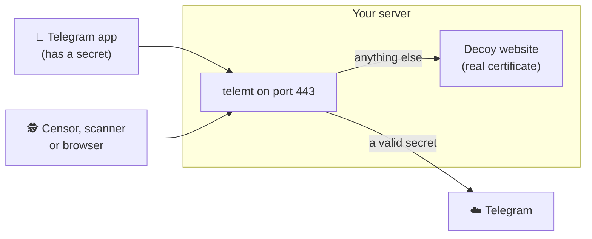

<p align="center">
  
</p>

<h1 align="center">burrowrs</h1>

<p align="center">
  <b>Your own stealthy Telegram proxy service.</b><br>
  One shared secret for everyone, or a secret per user with an expiry date, a data quota and a device limit.
</p>

<p align="center">
  <a href="https://github.com/deadboyccc/BurrowRs/actions/workflows/ci.yml"></a>
  <a href="https://github.com/deadboyccc/BurrowRs/releases"></a>
  <a href="LICENSE"></a>
  <a href="https://deadboyccc.github.io/BurrowRs/"></a>
</p>

burrowrs is [Burrow](https://github.com/deadboyccc/Burrow), rewritten on a Rust proxy engine
([telemt](https://github.com/telemt/telemt)), with per-user secrets. It runs a **Telegram
proxy** hidden behind a **real website with a real certificate**, in hardened Docker
containers, on a server you control. Telegram apps connect to it natively, with no extra
app. To everyone else (browsers, scanners, censors) it is just an ordinary website.

Digby the mole is back 🐾, now with a rust-orange scarf and a cog on it.

## Two ways to give access

| | **Shared** (default) | **Users** |
|---|---|---|
| Links | one link for everyone | one link per user |
| Revoke | `rotate`: everyone gets a new link | `user disable NAME`: only that user |
| Limits | none | expiry date, data quota (optionally reset daily, weekly or monthly), device limit |
| Live usage | totals in `status` | per user in `user list` |
| Choose it | `init` (or nothing) | `init --access users`, or later `config set ACCESS_MODE users` |

Per-user mode is built for running a small proxy service: add a user, send them their link,
renew them when they pay, disable them when they don't. Every change applies to the running
proxy at once, **without disconnecting anyone else**.

```bash
./burrowrs user add alice --days 30 --quota 50G --period monthly --ips 2
./burrowrs user list
./burrowrs user renew alice --days 30
./burrowrs user disable bob
```

## Install

On a fresh Debian or Ubuntu server, pick the command that fits you and paste it in.

**You have a domain.** Point its `A` record at the server first, then run this, with your
domain in place of `notes.example.com`:

```bash
curl -fsSL https://raw.githubusercontent.com/deadboyccc/BurrowRs/main/install.sh |
  sudo BURROWRS_DOMAIN=notes.example.com bash
```

**You have no domain.** Paste this as is. It finds the server's public IPv4 address and
uses it as a free wildcard-DNS name (`203-0-113-7.sslip.io`), which still gets a real
certificate. Share links point straight at the IP:

```bash
IP=$(curl -fsS4 https://api.ipify.org) &&
  curl -fsSL https://raw.githubusercontent.com/deadboyccc/BurrowRs/main/install.sh |
  sudo BURROWRS_DOMAIN="${IP//./-}.sslip.io" BURROWRS_LINK_HOST="$IP" bash
```

**For per-user secrets**, add `BURROWRS_ACCESS=users` to either command.

Either command:
- prepares the server: Docker, firewall, kernel tuning, swap on small servers, automatic
  updates and a watchdog;
- creates your secret and starts the proxy;
- tests it end to end, then prints your link and QR code.

**Run the same command again any time to upgrade.** Your secret and your users are kept.
Every option is listed in [Configuration](docs/CONFIGURATION.md).

| Prefer… | Do this |
|---|---|
| Step-by-step help, from renting a server to scanning the QR code | **[Deployment guide](docs/DEPLOY.md)** |
| Deploying from your laptop over SSH | `./burrowrs deploy root@203.0.113.7 --domain notes.example.com` |
| Trying it on your own machine first | `git clone https://github.com/deadboyccc/BurrowRs.git && cd burrowrs && ./burrowrs try` (add `--users` for per-user mode) |

## How it works



- A Telegram app's connection looks like ordinary HTTPS to your domain. Only someone who
  holds a secret can produce or recognise the difference.
- Everything else (probes, browsers, replayed or stale handshakes, wrong secrets) is passed
  to a real website with a real certificate, so it gets exactly what a normal site serves.
- Read more in **[Design](docs/DESIGN.md)**.

## Everyday use

Run these on the server, in `/opt/burrowrs`:

| Command | What it does |
|---|---|
| `./burrowrs status` | health, connections, traffic |
| `./burrowrs share` | your link and a QR code |
| `./burrowrs user add NAME` | per-user mode: a new user and their link |
| `./burrowrs user list` | per-user mode: everyone's state, expiry, quota and live usage |
| `./burrowrs rotate` | new secret (shared mode: every old link stops working) |
| `./burrowrs smoke` | full end-to-end self-test |
| `./burrowrs doctor` | diagnose the host, DNS, clock, config and proxy |

Every command is in **[Usage](docs/USAGE.md)**.

## What you get

- **Stealthy.** It looks like a normal HTTPS website, with a real certificate on your domain.
- **Per-user access.** Names, secrets, expiry dates, data quotas with automatic resets,
  device limits, live usage, all applied without restarts.
- **Hardened.**
  - Containers run non-root, on read-only filesystems, with no Linux capabilities.
  - Images are pinned by digest.
  - Secrets never appear in command lines or logs.
- **Private by default.** No access logs: successful connections are never logged. Refused
  ones (a disabled, expired or over-quota user, a replayed handshake) leave a warning, with
  the user name and sometimes the client's IP; `LOGGING=off` keeps no logs at all (details
  in the [threat model](docs/THREAT-MODEL.md#privacy)).
- **Self-healing.**
  - Crashed or frozen proxies restart themselves.
  - Certificates renew themselves, and security updates install themselves.
- **Light.** A Rust relay (telemt, a 32.5 MB image) with BBR network tuning. On a 1 vCPU,
  1 GB server it held 3,000 active connections at once with 219 MiB of memory and 17% CPU
  ([capacity](docs/OPERATIONS.md#capacity-measured)); idle, it uses about 5 MiB.
- **Tested.** 389 automated tests, including live connections to Telegram.

## Documentation

| Page | For |
|---|---|
| [Deployment guide](docs/DEPLOY.md) | getting a proxy running, step by step |
| [Usage](docs/USAGE.md) | commands, sharing, managing users, self-tests |
| [Configuration](docs/CONFIGURATION.md) | installer options, settings, your own decoy website |
| [Operations](docs/OPERATIONS.md) | capacity, monitoring, upgrades, backups, troubleshooting |
| [Threat model](docs/THREAT-MODEL.md) | what burrowrs protects against, what it doesn't, privacy |
| [Design](docs/DESIGN.md) | how it works, and why these technologies |
| [Development](docs/DEVELOPMENT.md) | tests, CI, project layout |
| [Changelog](CHANGELOG.md) · [Security policy](SECURITY.md) · [Contributing](CONTRIBUTING.md) · [Agent guide](AGENTS.md) | |

## Credits and license

burrowrs grew out of [Burrow](https://github.com/deadboyccc/Burrow) (MIT), which runs
[mtg](https://github.com/9seconds/mtg). The proxy engine is
[telemt](https://github.com/telemt/telemt) (TELEMT Public License 3, which allows commercial
use as long as its notices are kept), the decoy web server is [Caddy](https://caddyserver.com)
(Apache 2.0), and the tools use [segno](https://github.com/heuer/segno) and
[cryptography](https://cryptography.io). burrowrs runs telemt's official image unmodified.
Digby is original artwork made for Burrow, given a Rust makeover here.

burrowrs is released under the [MIT License](LICENSE). Telegram is a trademark of its
owners; burrowrs is an independent project, not affiliated with Telegram or telemt.
