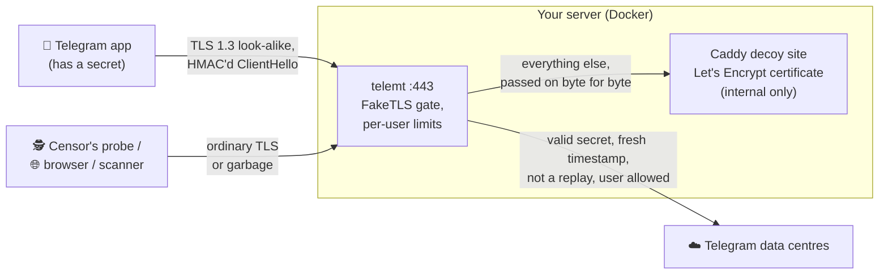
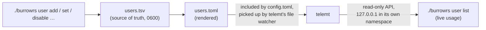

# Design

burrowrs is [Burrow](https://github.com/deadboyccc/Burrow) with a different proxy engine:
the same disguise, hardening, CLI and tests, with [telemt](https://github.com/telemt/telemt)
(Rust) in place of mtg (Go), because telemt can give every user a secret of their own.
Every choice below serves three goals: **safety**, **reliability** and **performance**.

## How a connection is handled

For each connection to port 443:

1. **Checks.** telemt checks the TLS ClientHello's 32-byte "random" field against every
   user's secret: for a real client it is an HMAC of the hello, keyed with that secret and
   mixed with a timestamp. It also checks that the timestamp is within 2 minutes and that
   this handshake hasn't been seen before.
2. **No secret matches** (or the SNI is some other name, or the bytes aren't TLS at all):
   telemt relays the connection, byte for byte, to the decoy web server (`mask`,
   `unknown_sni_action = "mask"`). The decoy completes a genuine TLS 1.3 handshake with a
   genuine certificate. A probe sees exactly what a browser sees.
3. **A secret matches:** telemt now knows which user this is, and answers with a
   ServerHello that proves it holds the same secret.
4. **Limits.** telemt checks that user's limits: enabled, not expired, quota left, not over
   the device limit. A refused user is disconnected. An allowed one has the encrypted
   MTProto stream relayed to the right Telegram data centre, wrapped in ordinary TLS
   records, with their traffic counted against their quota.

The decoy is never exposed on port 443 itself; the only way to it is *through* telemt. Port
80 goes straight to it, for certificate renewals and HTTP→HTTPS redirects, like any website.

Three details keep the disguise consistent:

- **TLS emulation.** telemt fetches the decoy's real certificate over the internal network
  and mirrors its sizes in the handshakes it sends to Telegram apps (`tls_emulation`), so
  they look like the site's own. In simple mode it fetches the cover site's.
- **The decoy has a fixed address.** It sits at `DECOY_IP` (default `10.204.47.10`) on a
  private Docker network, on port 8443, and telemt's `mask_host` is that literal IP, so
  masking never depends on name resolution.
- **Straight to Telegram.** telemt connects directly to Telegram's data centres. Only a
  sponsored channel (`AD_TAG`) switches it to Telegram's middle proxies, which need the
  server's public address.

## Users without restarts

- `users.tsv` is the list you manage; burrowrs validates every line and renders it to
  `state/telemt/users.toml`. telemt's main `config.toml` includes that file, so a user
  change never touches the main config, never changes the container's config hash, and
  never restarts the proxy. telemt watches its config files (inotify, plus a poll every 3
  seconds) and applies the new users and limits in place; burrowrs waits until telemt's API
  reports that the `access` settings it runs match the file. burrowrs never signals the
  container: `docker kill -s HUP` would make Docker stop restarting it after a crash.
- In shared mode the same file holds a single user, `owner`. In per-user mode `owner` is
  still there: it is the operator's own link, and the health checks use it.
- Live usage comes from telemt's control API, configured read-only and bound to 127.0.0.1
  inside the telemt container's network namespace. `user list` reads it through a
  short-lived `tools-api` container that joins that namespace; nothing else can reach it.
- Quota counters are written to the `telemt-data` volume, so they survive restarts.

## Two modes of disguise

| | **Stealth** (default) | **Simple** (last resort) |
|---|---|---|
| Needs | a domain pointing at the server, or a free name like `203-0-113-7.sslip.io` | nothing |
| What probes see | **your** site, **your** certificate | a third-party "cover" site, relayed |
| DNS, IP and SNI agree | ✅ | ❌ (the cover site doesn't live on your IP) |
| Ports | 443, plus 80 for certificates | 443 |

(These are independent of the two *access* modes, shared and users.)

## Why these technologies

### Protocol: MTProto proxy with FakeTLS

| Option | Verdict |
|---|---|
| **MTProto proxy, FakeTLS (`ee` secrets)** ✅ | Built into every official Telegram app and shared as one link or QR code. The handshake is a TLS 1.3 ClientHello that only a secret holder can produce or recognise. |
| SOCKS5 proxy | Also built into Telegram, but its plaintext handshake is easy to fingerprint. |
| VPN (WireGuard, VLESS/Reality, …) | Excellent, but needs an extra app on every device and tunnels everything. |
| Legacy secrets (plain / `dd`) | Detectable by traffic analysis; switched off in burrowrs (`classic = false`, `secure = false`). |

### Proxy: telemt

| Option | Verdict |
|---|---|
| **[telemt](https://github.com/telemt/telemt) (Rust)** ✅ | Memory-safe, no garbage collector, actively developed. FakeTLS with masking to a real site and TLS emulation, anti-replay, and per-user secrets with expiry, quotas with UTC resets, device limits, live reloads, a read-only API and Prometheus metrics. The official image is 32.5 MB. Its licence (TELEMT Public License 3) allows commercial use as long as the notices are kept. |
| [mtg](https://github.com/9seconds/mtg) v2 (Go) | What Burrow uses: mature and small, but one secret per proxy by design, so no per-user access. |
| mtprotoproxy (Python) | Many users per proxy, but slower. |
| Telegram's official MTProxy (C) | Unmaintained for years, memory-unsafe, no FakeTLS fronting. |

### Disguise: your own domain, real site, real certificate

Claiming to be `microsoft.com` from a random VPS fools no one, because one DNS lookup shows
`microsoft.com` doesn't live there. The robust setup is a domain you own, pointing at your
server, with a real website and a real Let's Encrypt certificate, and the proxy in front of
it. DNS, SNI and the certificate then all agree. burrowrs automates exactly this as
**stealth mode**.

### Packaging: hardened Docker Compose and one CLI

- **Containers** run as an unprivileged user (uid 65534), on read-only filesystems, with
  every Linux capability dropped, `no-new-privileges`, memory and process limits, and
  images pinned by digest. telemt's official image runs unmodified.
- **One entry point:** `./burrowrs`, plain Bash with no dependencies beyond Docker. It
  generates every config file, so you never hand-edit TOML or a Caddyfile.
- **Tested like software:** see [Development](DEVELOPMENT.md).
